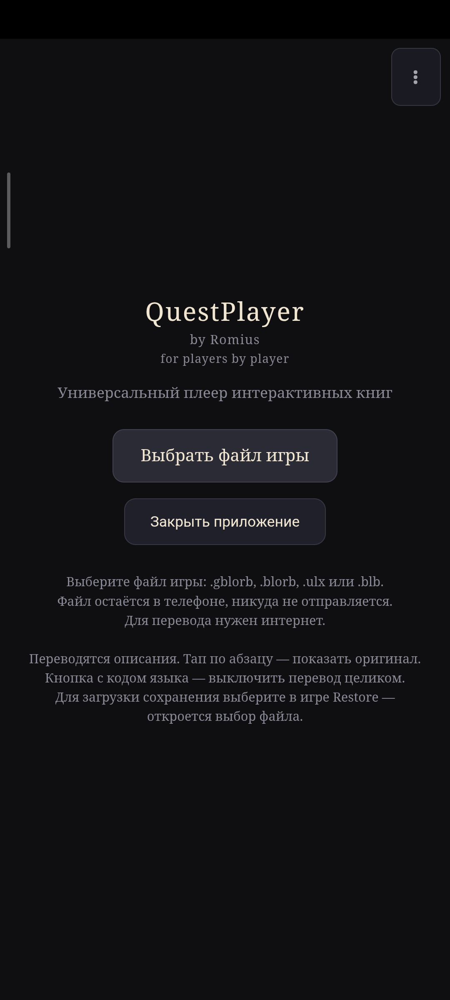
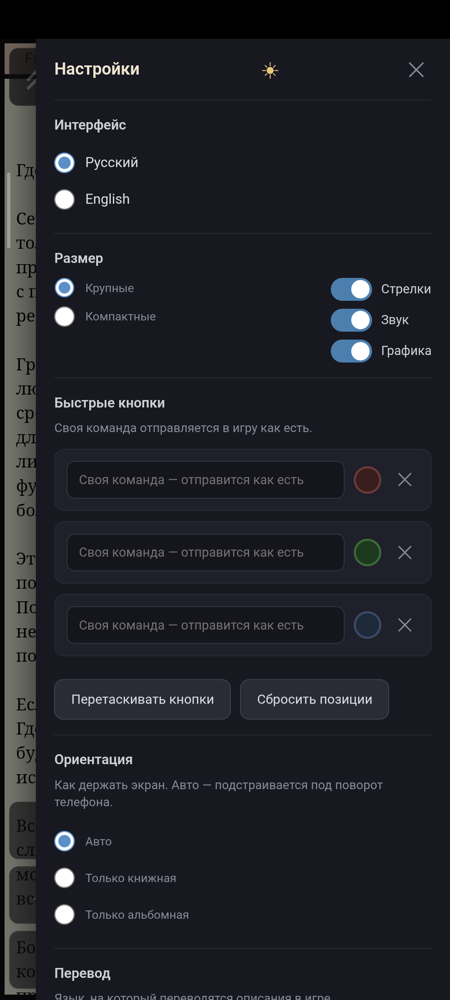
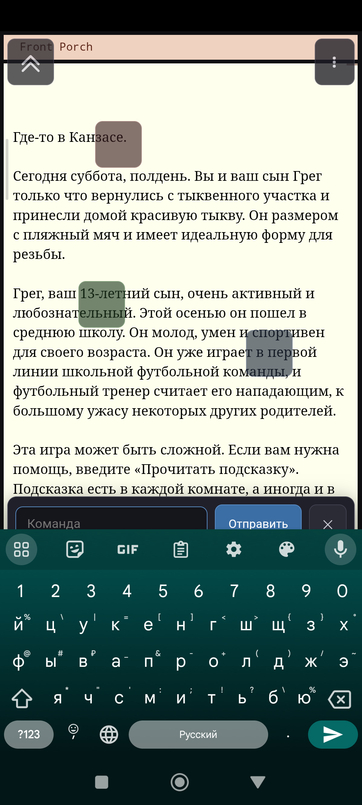

# QuestPlayer

[](https://github.com/RomiusGod/QuestPlayer/releases/latest)
[](LICENSE)
[](https://github.com/RomiusGod/QuestPlayer)

Плеер интерактивных книг для Android. Автор — Romius.

An interactive fiction player for Android. By Romius.

Я собрал это, когда захотел поиграть в большую Glulx-игру на телефоне, а ни один плеер её не открыл — то памяти не хватало, то файл не влезал. Так что QuestPlayer не боится тяжёлых файлов: пока обычные мобильные аналоги рассчитаны на игры в несколько мегабайт и на файле потяжелее сдаются, этот тянет до гигабайта — большие Glulx-игры с ресурсами, звуком и графикой открываются и идут. Под капотом — виртуальная машина Glulx, спроектированная Эндрю Плоткиным (Zarf), и её JavaScript-интерпретатор Quixe от того же автора; jQuery в сборке — историческая зависимость Quixe/GlkOte, не прихоть. Остальное — приятные детали.

I built this when I wanted to play a big Glulx game on my phone and no player would open it — either it ran out of memory or the file just wouldn't fit. So QuestPlayer doesn't flinch at heavy files: while typical mobile alternatives are built for games of a few megabytes and give up on anything heavier, this one handles up to a gigabyte — large Glulx games with resources, sound and graphics open and run. Under the hood are the Glulx virtual machine, designed by Andrew Plotkin (Zarf), and Quixe, his JavaScript interpreter for it; jQuery is in the build as a historical dependency of Quixe/GlkOte, not a whim. The rest is nice detail.

| | | |
|:--:|:--:|:--:|
|  |  |  |

## Почему он вообще нужен / Why it's needed

На телефоне интерактивные книги обычно упираются в память и в браузерные лимиты: localStorage кончается на ~5 МБ, вкладка падает, сейв не влезает. Здесь хранилище построено иначе — крупные данные уходят в IndexedDB, которая переживает перезагрузку и не задыхается на десятках мегабайт. Сейв большой Glulx-игры не проблема, даже если он весит около 20 МБ.

On a phone, interactive fiction usually hits memory and browser limits: localStorage caps at ~5 MB, the tab crashes, the save won't fit. Storage here is built differently — large data goes to IndexedDB, which survives reloads and doesn't choke on tens of megabytes. A save for a big Glulx game is no problem, even when it is around 20 MB.

## Что уже работает / What works

Движок: реализован Glulx — файлы .gblorb, .blorb, .ulx. Движок вынесен в отдельный файл: монолита на HTML больше нет, так что добавлять новые движки будет проще. Загрузка простая: стартовый экран → «Выбрать файл игры» → игра пошла.

The engine: Glulx is implemented — .gblorb, .blorb, .ulx files. The engine lives in its own file: no more HTML monolith, so adding new engines will be easier. Loading is simple: start screen → "Choose game file" → you're in.

## Перевод / Translation

По мере сборки я понял, что можно прикрутить и перевод — очень удобно, хоть качество и не идеально. Если кто-то сможет показать лучшую реализацию — милости прошу.

As I was building it, I realized translation could be wired in too — very handy, even if the quality isn't perfect. If someone can show a better implementation, you're welcome to.

Описания переводятся на выбранный язык (по умолчанию — язык интерфейса; в настройках 19 языков). Кнопка перевода показывает целевой язык — RU, EN или другой — а когда перевод выключен, на ней написано OFF. Тап по абзацу показывает оригинал этого абзаца. Нужен интернет; без сети игра идёт, просто без перевода. Введённые тобой команды не переводятся — они уходят в игру как есть.

Descriptions get translated into the language you choose (the UI language by default; 19 languages in settings). The translate button shows the target language — RU, EN or another — and reads OFF when translation is disabled. Tap a paragraph to see its original. Needs internet; offline the game still runs, just untranslated. Your input commands are never translated — they go to the game as-is.

## Управление / Controls

Стрелки и Enter — для меню и перелистывания. Кнопка ⌨ открывает строку ввода; в APK это обычное поле плюс системная клавиатура, и окно игры не прыгает — строку просто поднимаем над клавиатурой. ⛶ — полный экран. Быстрые кнопки — свои команды, которые уходят в игру как есть; их можно добавлять, красить и перетаскивать, позиции запоминаются.

Arrows and Enter handle menus and paging. The ⌨ button opens the command line; in the APK it's a normal field plus the system keyboard, and the game window doesn't jump — we just lift the bar above the keyboard. ⛶ toggles fullscreen. Quick buttons are your own commands sent verbatim; add, colour and drag them, positions are remembered.

### Настройки (⋮) / Settings (⋮)

Размер кнопок (крупные/компактные), переключатели стрелок, звука и графики, ориентация (авто / книжная / альбомная), язык интерфейса (русский/английский), светлая и тёмная тема. Сохранения: сейв при выходе автоматически скачивается в «Загрузки», Restore в игре сразу открывает выбор файла с телефона, есть экспорт всех и импорт одного. Плюс импорт/выгрузка данных игр и лог для диагностики.

Button size (large/compact), toggles for arrows, sound and graphics, orientation (auto / portrait / landscape), UI language (Russian/English), light and dark theme. Saves: the save on exit is auto-downloaded to Downloads, Restore in-game opens the phone's file picker right away, plus export-all and import-one. Also import/export of game data and a diagnostic log.

## Другие движки / Other engines

Сейчас поддержан Glulx. Движки для других форматов — в планах; по мере готовности они появятся в плеере.

Glulx is supported today. Engines for other formats are planned and will arrive as they're ready.

## Приватность / Privacy

Файлы не покидают телефон. Наружу уходит только текст на перевод — и только если перевод включён. Сохранения локальные. Никакой аналитики, никаких аккаунтов.

Files never leave your phone. Only text for translation goes out — and only when translation is on. Saves are local. No analytics, no accounts.

## Кто делает / Who made it

Собрал Romius. Сломалось — включи лог, экспортируй, пришли. Работает — просто читай.

Built by Romius. Broken — turn on the log, export it, send it. Works — just read.

## Как начать / Getting started

### Как начать

1. Положите рядом `QuestPlayer.html` и папку `engines` — без неё книга не запустится, движок подгружается отдельно.
2. Откройте страницу через любой локальный сервер: `python -m http.server`, `npx serve` или «Live Server» в редакторе. Просто двойным щелчком по файлу (`file://`) браузер не даст странице загрузить движок.
3. Выберите книгу: `.gblorb`, `.blorb`, `.ulx` или `.blb`.

Дальше всё как в игре: печатаете или нажимаете кнопки, книга отвечает.

### Getting started

1. Put `QuestPlayer.html` and the `engines` folder side by side — without it the book won't start, the engine is loaded separately.
2. Open the page through any local server: `python -m http.server`, `npx serve`, or Live Server in your editor. Opening the file directly (`file://`) won't let the page load the engine.
3. Choose a book: `.gblorb`, `.blorb`, `.ulx` or `.blb`.

From there it's just like playing: type or press the buttons, and the book answers.

---

## Что на экране / On screen

**Стартовый экран** — название, «by Romius», «for players by player», большая кнопка «Выбрать файл игры» и короткая памятка. Справа сверху — те же три точки `⋮`, что и в игре: отдельной кнопки «Настройки» больше нет, настройки всегда в одном месте.

**Start screen** — the title, "by Romius", "for players by player", a big "Choose game file" button and a short note. Top right — the same three dots `⋮` as in-game: there's no separate "Settings" button anymore, settings always live in one place.

**В игре** — слева стрелки и `⏎`, справа быстрые кнопки, сверху `⋮`. Панель с кнопками можно перетаскивать («Перетаскивать кнопки» в настройках).

**In-game** — arrows and `⏎` on the left, quick buttons on the right, `⋮` on top. The button panel can be dragged ("Drag buttons" in settings).

**Настройки** (`⋮`) — язык интерфейса, размер, стрелки/звук/графика, быстрые кнопки, ориентация, перевод, сохранения, данные игр, файл игры, приложение, диагностика. Внизу — версия, сборка и копирайт.

**Settings** (`⋮`) — UI language, size, arrows/sound/graphics, quick buttons, orientation, translation, saves, game data, game file, app, diagnostics. At the bottom — version, build and copyright.

---

## Что где лежит / What's where

| Файл / File | Зачем / Why |
| --- | --- |
| `QuestPlayer.html` | Вся страница: разметка, стили, интерфейс, перевод, сейвы, мост / The whole page: markup, styles, UI, translation, saves, bridge |
| `engines/glulx.js` | Движок Glulx (GlkOte + Quixe + Glk + Dialog + Blorb + GiLoad) / The Glulx engine (GlkOte + Quixe + Glk + Dialog + Blorb + GiLoad) |
| `engines/README.md` | Как устроен реестр движков и как добавить новый / How the engine registry works and how to add a new one |
| `smoke.html` | Самопроверка: открыть по HTTP, выбрать небольшую книгу, ждать PASS / Self-check: open over HTTP, pick a small book, wait for PASS |
| `android/` | Исходники обёртки: манифест, Java-мост, ресурсы / Wrapper sources: manifest, Java bridge, resources |
| `LICENSE` | MIT |

---

## Как устроен QuestPlayer.html / How QuestPlayer.html is organized

Файл читается сверху вниз: две таблицы стилей и три `<script>`.

The file reads top to bottom: two stylesheets and three `<script>` blocks.

| Что / What | Где искать / Where to look |
| --- | --- |
| Две таблицы CSS / Two CSS tables | `GlkOte default stylesheet`, затем / then `html, body { … }` — своя разметка / own layout |
| Big-storage shim | «Big-storage shim» — большие сейвы уезжают из `localStorage` в IndexedDB / large saves move from `localStorage` to IndexedDB |
| jQuery 1.12.4 | `/*! jQuery v1.12.4` — нужен движку / needed by the engine |
| Всё остальное / Everything else | `(function () { 'use strict';` — интерфейс плеера / the player UI |

Внутри последнего блока тоже есть карта — по названиям разделов, а не по номерам строк (номера уезжают после первой же правки). Порядок такой:

Inside the last block there's a map too — by section names, not line numbers (numbers drift after the first edit). The order is:

| Раздел / Section | Ищите / Search for |
| --- | --- |
| Диагностика ввода / Input diagnostics | «Диагностика ввода: короткий журнал» |
| Языки интерфейса / UI languages | «Interface language» → `var I18N = {` |
| Настройки UI / UI settings | «Persistent UI settings» |
| Цвета / Colours | «PALETTE — единственный источник цветов» |
| Тосты / Toasts | «Toast» |
| Перевод / Translation | «Translation engine» |
| Клавиатура и кнопки / Keyboard and buttons | «Keyboard / on-screen key control» |
| Сейвы / Saves | «File-based saves» |
| Данные игр (APK) / Game data (APK) | «Native game data (APK only)» |
| Движки / Engines | «Движки» → `var ENGINES = {` |
| Загрузка игры и ошибки / Game loading and errors | «Game loading / errors» |
| Привязка интерфейса / UI bindings | «UI bindings» |

Кода интерпретатора в файле нет — он лежит в `engines/`. Поэтому страница открывается мгновенно, а движок грузится только когда вы выбрали книгу.

There's no interpreter code in the file — it lives in `engines/`. That's why the page opens instantly and the engine loads only when you pick a book.

---

## Расширенная сборка: три вставки / Extended build: three insertions

Обычная версия — чистый код: ни одной проверки «а не расширенная ли это копия», ни флагов, ни условных ветвей. Логика одна и та же, просто меньше возможностей.

The regular version is clean code: not a single "is this the extended copy?" check, no flags, no conditional branches. The logic is the same, just fewer features.

Расширенная сборка получается копированием трёх кусков ниже в `QuestPlayer.html`. Ничего больше править не нужно: нашли место, заменили или вставили, сохранили.

The extended build is made by copying the three snippets below into `QuestPlayer.html`. Nothing else to edit: find the spot, replace or insert, save.

### 1. Пять быстрых кнопок / Five quick buttons

Найдите в `var DEFAULTS = {` строку `quickMax: 3,` и замените на:

Find the line `quickMax: 3,` inside `var DEFAULTS = {` and replace it with:

```js
quickMax: 5,
```

Всё. Место кнопки считает CSS по её индексу (`--tq-qi`), поэтому пятая встанет под четвёртой, а двадцатая — под девятнадцатой. Сами кнопки и их цвета лежат в `ui.json` игры.

That's it. The button position is computed by CSS from its index (`--tq-qi`), so the fifth lands under the fourth, and the twentieth under the nineteenth. The buttons themselves and their colours live in the game's `ui.json`.

### 2. Шестнадцать цветов кнопок / Sixteen button colours

Найдите блок от `var BTN_COLORS = [` до `];` (он стоит перед `var POS_KEYS`) и замените целиком:

Find the block from `var BTN_COLORS = [` to `];` (it sits before `var POS_KEYS`) and replace it entirely:

<!--extra:colors-->
```js
  var BTN_COLORS = [
    { id: 'default', bg: PALETTE.surfaceTool, fg: PALETTE.textDim, border: PALETTE.borderLight },
    { id: 'red',     bg: '#3a1e1e', fg: '#f0c8c8', border: '#6a3a3a' },
    { id: 'orange',  bg: '#3a2a1e', fg: '#f0d8c8', border: '#6a4a3a' },
    { id: 'yellow',  bg: '#3a3a1e', fg: '#f0f0c8', border: '#6a6a3a' },
    { id: 'green',   bg: '#1e3a1e', fg: '#c8f0c8', border: '#3a6a3a' },
    { id: 'teal',    bg: '#1e3a3a', fg: '#c8f0f0', border: '#3a6a6a' },
    { id: 'blue',    bg: '#1e2a3a', fg: '#c8d8f0', border: '#3a4a6a' },
    { id: 'purple',  bg: '#2a1e3a', fg: '#d8c8f0', border: '#4a3a6a' },
    { id: 'pink',    bg: '#3a1e2a', fg: '#f0c8d8', border: '#6a3a4a' },
    { id: 'cyan',    bg: '#1e3a36', fg: '#c8f0ea', border: '#3a6a64' },
    { id: 'lime',    bg: '#2a3a1e', fg: '#e2f0c8', border: '#4a6a3a' },
    { id: 'olive',   bg: '#33331e', fg: '#f0eec8', border: '#5e5e3a' },
    { id: 'brown',   bg: '#33261e', fg: '#f0dcc8', border: '#5e463a' },
    { id: 'magenta', bg: '#3a1e33', fg: '#f0c8e8', border: '#6a3a5e' },
    { id: 'slate',   bg: '#242a33', fg: '#d2dae6', border: '#445061' },
    { id: 'sand',    bg: '#33301e', fg: '#f0e8c8', border: '#615a3a' }
  ];
```
<!--/extra:colors-->

Сетка в настройках считает столбцы сама: 16 цветов лягут 4×4, 25 — 5×5. Старые `ui.json` не ломаются — незнакомый цвет становится `default`.

The settings grid computes columns itself: 16 colours lay out 4×4, 25 — 5×5. Old `ui.json` files keep working — an unknown colour becomes `default`.

### 3. Цвет интерфейса / Interface colour

Найдите в `function init()` строку `    applyPalette();` и вставьте блок сразу после неё:

Find the line `    applyPalette();` inside `function init()` and insert the block right after it:

<!--extra:theme-->
```js
    /* Цвет интерфейса: палитра собирается из одного цвета. */
    var tqSeedDraw = function () {};
    var tqSeedState = { h: 210, s: 0.55, v: 0.65 };
    var tqSeedBase = {};
    (function () {
      for (var tqK in PALETTES.dark) if (Object.prototype.hasOwnProperty.call(PALETTES.dark, tqK)) tqSeedBase[tqK] = PALETTES.dark[tqK];
    })();

    I18N.ru.themeColor = 'Цвет интерфейса';
    I18N.ru.themeColorNote = 'Любой цвет — из него собирается вся палитра. Светлая и тёмная темы остаются светлой и тёмной.';
    I18N.ru.themeColorReset = 'Сбросить';
    I18N.en.themeColor = 'Interface colour';
    I18N.en.themeColorNote = 'Any colour — the whole palette is built from it. Light and dark stay light and dark.';
    I18N.en.themeColorReset = 'Reset';

    function tqSeedHsl(h, s, l) {
      h = ((h % 360) + 360) % 360; s = Math.max(0, Math.min(100, s)) / 100; l = Math.max(0, Math.min(100, l)) / 100;
      var a = s * Math.min(l, 1 - l);
      function f(n) {
        var k = (n + h / 30) % 12;
        var c = l - a * Math.max(-1, Math.min(k - 3, Math.min(9 - k, 1)));
        var v = Math.round(255 * c).toString(16);
        return v.length < 2 ? '0' + v : v;
      }
      return '#' + f(0) + f(8) + f(4);
    }

    function tqSeedHex() {
      var h = tqSeedState.h, s = tqSeedState.s, v = tqSeedState.v;
      var c = v * s, x = c * (1 - Math.abs(((h / 60) % 2) - 1)), m = v - c;
      var r = 0, g = 0, b = 0;
      if (h < 60) { r = c; g = x; } else if (h < 120) { r = x; g = c; }
      else if (h < 180) { g = c; b = x; } else if (h < 240) { g = x; b = c; }
      else if (h < 300) { r = x; b = c; } else { r = c; b = x; }
      function q(n) {
        var k = Math.round((n + m) * 255).toString(16);
        return k.length < 2 ? '0' + k : k;
      }
      return '#' + q(r) + q(g) + q(b);
    }

    function tqSeedParse(hex) {
      var m = /^#?([0-9a-fA-F]{3}|[0-9a-fA-F]{6})$/.exec(String(hex || '').replace(/\s+/g, ''));
      if (!m) return null;
      var s = m[1];
      if (s.length === 3) s = s.charAt(0) + s.charAt(0) + s.charAt(1) + s.charAt(1) + s.charAt(2) + s.charAt(2);
      s = s.toLowerCase();
      var r = parseInt(s.slice(0, 2), 16) / 255, g = parseInt(s.slice(2, 4), 16) / 255, b = parseInt(s.slice(4, 6), 16) / 255;
      var max = Math.max(r, g, b), min = Math.min(r, g, b), d = max - min, hh = 0;
      if (d) {
        if (max === r) hh = 60 * (((g - b) / d) % 6);
        else if (max === g) hh = 60 * ((b - r) / d + 2);
        else hh = 60 * ((r - g) / d + 4);
      }
      return { h: ((hh % 360) + 360) % 360, s: max ? d / max : 0, v: max, hex: '#' + s };
    }

    /* Тёмная палитра: фон и панели тонируются выбранным оттенком,
       текст остаётся светлым, акцент — сам выбранный цвет. */
    function tqSeedPalette(seed) {
      var out = {}, k, base = tqSeedBase;
      for (k in base) if (Object.prototype.hasOwnProperty.call(base, k)) out[k] = base[k];
      if (!seed) return out;
      var h = seed.h, s = seed.s;
      var skin = 6 + 12 * s;
      out.surface = tqSeedHsl(h, skin, 10);
      out.surface2 = tqSeedHsl(h, skin, 13);
      out.surface3 = tqSeedHsl(h, skin, 17);
      out.surfaceHover = tqSeedHsl(h, skin, 23);
      out.surfaceInset = tqSeedHsl(h, skin, 7);
      out.surfaceTool = tqSeedHsl(h, skin, 12);
      out.surfaceToolActive = tqSeedHsl(h, skin, 19);
      out.border = tqSeedHsl(h, skin, 16);
      out.borderLight = tqSeedHsl(h, skin + 2, 26);
      out.borderInput = tqSeedHsl(h, skin, 20);
      out.borderFocus = tqSeedHsl(h, 50, 56);
      out.text = tqSeedHsl(h, 6, 86);
      out.textDim = tqSeedHsl(h, 6, 80);
      out.textMute = tqSeedHsl(h, 6, 58);
      out.textStrong = tqSeedHsl(h, 18, 90);
      out.textInverse = '#ffffff';
      out.accent = tqSeedHsl(h, 40 + 25 * s, 40);
      out.accentHover = tqSeedHsl(h, 40 + 25 * s, 48);
      out.accentBorder = tqSeedHsl(h, 45 + 25 * s, 56);
      out.accentSoft = tqSeedHsl(h, 65, 72);
      out.knob = tqSeedHsl(h, 6, 72);
      out.toastBorder = tqSeedHsl(h, 10, 30);
      out.pageBg = tqSeedHsl(h, 14, 6);
      out.startBg = tqSeedHsl(h, 14, 6);
      out.startH1 = tqSeedHsl(h, 18, 90);
      out.headerBgDark = tqSeedHsl(h, 45, 17);
      out.headerFgDark = tqSeedHsl(h, 60, 90);
      return out;
    }

    function tqSeedApply(hex) {
      var seed = hex ? tqSeedParse(hex) : null;
      PALETTES.dark = tqSeedPalette(seed);
      applyPalette();
      applyTheme();
      BTN_COLORS[0] = { id: 'default', bg: PALETTE.surfaceTool, fg: PALETTE.textDim, border: PALETTE.borderLight };
      try {
        if (seed) localStorage.setItem('tq.uiColor', seed.hex);
        else localStorage.removeItem('tq.uiColor');
      } catch (e) {}
      refreshQuickButtons();
      buildQuickSlots();
      tqSeedDraw();
      var inp = $('tq-seed-hex');
      if (inp) inp.value = seed ? seed.hex : '';
    }

    function tqSeedPanel() {
      var sheet = document.querySelector('#tq-panel .tq-sheet');
      if (!sheet || $('tq-seed')) return;

      var caret = document.createElement('button');
      caret.type = 'button';
      caret.id = 'tq-seed-toggle';
      caret.textContent = '▾';
      caret.setAttribute('aria-label', t('themeColor'));
      caret.style.cssText = 'font:16px/1 system-ui;padding:6px;margin-left:6px';
      var toggle = $('tq-theme-toggle');
      if (toggle && toggle.parentNode) toggle.parentNode.insertBefore(caret, toggle.nextSibling);
      else sheet.querySelector('.tq-head').appendChild(caret);

      var group = document.createElement('div');
      group.className = 'tq-group';
      group.id = 'tq-seed';
      group.hidden = true;
      group.innerHTML =
        '<div class="tq-title" data-tq="themeColor">Цвет интерфейса</div>' +
        '<div class="tq-note" data-tq="themeColorNote"></div>' +
        '<canvas id="tq-seed-wheel" width="200" height="200" ' +
          'style="display:block;margin:8px auto;touch-action:none"></canvas>' +
        '<div style="display:flex;gap:8px;align-items:center">' +
          '<input id="tq-seed-hex" type="text" autocomplete="off" spellcheck="false" placeholder="#3b6ea5" ' +
            'style="flex:1;min-width:0;padding:8px;border-radius:8px;border:1px solid var(--tq-borderInput);' +
            'background:var(--tq-surfaceInset);color:var(--tq-text);font:14px monospace">' +
          '<button id="tq-seed-reset" type="button" data-tq="themeColorReset" ' +
            'style="padding:8px 12px;border-radius:8px;border:1px solid var(--tq-borderLight);' +
            'background:var(--tq-surface3);color:var(--tq-textStrong);font:14px system-ui,sans-serif"></button>' +
        '</div>';
      sheet.insertBefore(group, sheet.querySelector('.tq-group'));

      /* Стрелка стоит у темы: отступ от неё — 1/5 зазора до крестика. */
      function placeCaret() {
        var tgl = $('tq-theme-toggle'), cls = $('tq-panel-close');
        if (!tgl || !cls) return;
        tgl.style.marginRight = '0';
        caret.style.marginRight = 'auto';
        caret.style.marginLeft = '0';
        var space = cls.getBoundingClientRect().left - tgl.getBoundingClientRect().right -
          caret.getBoundingClientRect().width;
        if (space <= 0) return;
        caret.style.marginLeft = Math.max(2, Math.round(space / 5)) + 'px';
      }
      placeCaret();
      window.addEventListener('resize', placeCaret);
      if (window.MutationObserver) {
        new MutationObserver(placeCaret).observe(document.body, { attributes: true, attributeFilter: ['class'] });
      }

      caret.addEventListener('click', function () {
        placeCaret();
        group.hidden = !group.hidden;
        caret.textContent = group.hidden ? '▾' : '▴';
      });

      var cv = $('tq-seed-wheel');
      var ctx = cv.getContext('2d');
      var R = 88, ring = 20, S = 96, half = S / 2;

      function draw() {
        var cx = cv.width / 2, cy = cv.height / 2;
        ctx.clearRect(0, 0, cv.width, cv.height);
        for (var a = 0; a < 360; a++) {
          ctx.beginPath();
          ctx.strokeStyle = tqSeedHsl(a, 90, 50);
          ctx.lineWidth = ring;
          ctx.arc(cx, cy, R - ring / 2, (a - 0.7) * Math.PI / 180, (a + 1.3) * Math.PI / 180);
          ctx.stroke();
        }
        var x0 = cx - half, y0 = cy - half;
        var g1 = ctx.createLinearGradient(x0, 0, x0 + S, 0);
        g1.addColorStop(0, '#ffffff');
        g1.addColorStop(1, tqSeedHsl(tqSeedState.h, 100, 50));
        ctx.fillStyle = g1;
        ctx.fillRect(x0, y0, S, S);
        var g2 = ctx.createLinearGradient(0, y0, 0, y0 + S);
        g2.addColorStop(0, 'rgba(0,0,0,0)');
        g2.addColorStop(1, 'rgba(0,0,0,1)');
        ctx.fillStyle = g2;
        ctx.fillRect(x0, y0, S, S);
        ctx.strokeStyle = 'rgba(255,255,255,0.55)';
        ctx.lineWidth = 3;
        ctx.beginPath();
        ctx.arc(cx + Math.cos(tqSeedState.h * Math.PI / 180) * (R - ring / 2),
                cy + Math.sin(tqSeedState.h * Math.PI / 180) * (R - ring / 2), 6, 0, Math.PI * 2);
        ctx.stroke();
        var sx = x0 + tqSeedState.s * S;
        var sy = y0 + (1 - tqSeedState.v) * S;
        ctx.beginPath();
        ctx.arc(sx, sy, 6, 0, Math.PI * 2);
        ctx.strokeStyle = '#000';
        ctx.lineWidth = 2;
        ctx.stroke();
        ctx.beginPath();
        ctx.arc(sx, sy, 4.5, 0, Math.PI * 2);
        ctx.strokeStyle = '#fff';
        ctx.lineWidth = 1.5;
        ctx.stroke();
      }
      tqSeedDraw = draw;

      function pick(ev) {
        var r = cv.getBoundingClientRect();
        var x = (ev.clientX - r.left) * (cv.width / r.width) - cv.width / 2;
        var y = (ev.clientY - r.top) * (cv.height / r.height) - cv.height / 2;
        var d = Math.sqrt(x * x + y * y);
        if (d > R - ring - 2 && d < R + 4) {
          tqSeedState.h = ((Math.atan2(y, x) * 180 / Math.PI) + 360) % 360;
          return true;
        }
        if (Math.abs(x) <= half && Math.abs(y) <= half) {
          tqSeedState.s = Math.min(1, Math.max(0, (x + half) / S));
          tqSeedState.v = Math.min(1, Math.max(0, 1 - (y + half) / S));
          return true;
        }
        return false;
      }

      function onMove(ev) {
        if (!cv.__tqSeedDrag) return;
        if (ev.cancelable) ev.preventDefault();
        if (pick(ev)) tqSeedApply(tqSeedHex());
      }
      cv.addEventListener('pointerdown', function (ev) {
        cv.__tqSeedDrag = true;
        try { cv.setPointerCapture(ev.pointerId); } catch (e) {}
        onMove(ev);
      });
      cv.addEventListener('pointermove', onMove);
      cv.addEventListener('pointerup', function () { cv.__tqSeedDrag = false; });
      cv.addEventListener('pointercancel', function () { cv.__tqSeedDrag = false; });

      $('tq-seed-hex').addEventListener('change', function () {
        var p = tqSeedParse(this.value);
        if (!p) { this.value = tqSeedHex(); return; }
        tqSeedState.h = p.h; tqSeedState.s = p.s; tqSeedState.v = p.v;
        tqSeedApply(p.hex);
      });
      $('tq-seed-reset').addEventListener('click', function () { tqSeedApply(''); });
    }

    tqSeedPanel();
    try {
      var tqSeedSaved = localStorage.getItem('tq.uiColor');
      if (tqSeedSaved) {
        var tqSeedParsed = tqSeedParse(tqSeedSaved);
        if (tqSeedParsed) {
          tqSeedState.h = tqSeedParsed.h;
          tqSeedState.s = tqSeedParsed.s;
          tqSeedState.v = tqSeedParsed.v;
          tqSeedApply(tqSeedParsed.hex);
        }
      }
    } catch (e) {}
    tqSeedDraw();
```
<!--/extra:theme-->

Рядом со значком темы (луна/солнце) появляется стрелка `▾`: по ней открывается «Цвет интерфейса» — круговой выбор оттенка, квадрат насыщенности и яркости, поле HEX и «Сбросить». Из одного цвета собирается вся тёмная палитра интерфейса: фон и панели тонируются оттенком, акцент — сам цвет, текст остаётся светлым. Светлая и тёмная темы книги (`cfg.theme`) при этом не меняются. Выбор запоминается в `localStorage` (`tq.uiColor`).

Next to the theme icon (moon/sun) a `▾` caret appears: it opens "Interface colour" — a hue wheel, a saturation/brightness square, a HEX field and "Reset". The whole dark UI palette is built from one colour: background and panels are tinted with the hue, the accent is the colour itself, text stays light. The book's light and dark themes (`cfg.theme`) are untouched. The choice is stored in `localStorage` (`tq.uiColor`).

---

## Обмен данными между сборками / Sharing data between builds

Обычная и расширенная сборки — разные приложения, и их внутренние каталоги друг друга не видят. Поэтому обмен идёт через один файл в папке, которую вы выбрали сами один раз и к которой приложение сохраняет доступ.

The regular and extended builds are separate apps, and their internal directories can't see each other. So sharing goes through a single file in a folder you pick once yourself, and the app keeps access to it.

1. В обычной сборке: `⋮` → «Данные игр» → «Выгрузить в папку».
2. В расширенной: `⋮` → «Данные игр» → «Принять из папки».

1. In the regular build: `⋮` → "Game data" → "Export to folder".
2. In the extended build: `⋮` → "Game data" → "Import from folder".

Правила простые и предсказуемые:

The rules are simple and predictable:

- сохранения с тем же именем не затирают друг друга, а добавляются с номером;
- остальные файлы игры (настройки, `ui.json`) обновляются;
- быстрые кнопки остаются ваши: если в игре уже есть кнопки, приём их не трогает.

- saves with the same name don't overwrite each other, they're added with a number;
- the rest of the game files (settings, `ui.json`) are updated;
- quick buttons stay yours: if the game already has buttons, importing leaves them alone.

---

## Движки / Engines

В `QuestPlayer.html` нет кода виртуальной машины. Формат определяется по расширению и сигнатуре файла, а движок подгружается из `engines/` только когда он действительно нужен. Сейчас поддержан Glulx (`engines/glulx.js`).

There's no virtual-machine code in `QuestPlayer.html`. The format is detected by file extension and signature, and the engine is loaded from `engines/` only when it's actually needed. Glulx is supported today (`engines/glulx.js`).

Добавить движок — две строки в реестре: новый файл в `engines/` и запись в `ENGINES`. Подробности — в `engines/README.md`. Фильтр в выборе файла и текст ошибки «не понял, что это за файл» берутся из этого же реестра, так что разметку править не нужно.

Adding an engine is two lines in the registry: a new file in `engines/` and an entry in `ENGINES`. Details are in `engines/README.md`. The file-picker filter and the "I don't recognize this file" error both come from that registry, so you don't touch the markup.

---

## Сборка APK / Building the APK

APK — это WebView, который открывает `assets/index.html` и отдаёт странице мост `AndroidBridge`. Минимум — Android 7.0 (API 24), пакет `com.romius.questplayer`, `versionName` — 1.0, `versionCode` растёт с каждой сборкой.

The APK is a WebView that opens `assets/index.html` and exposes the `AndroidBridge` to the page. Minimum — Android 7.0 (API 24), package `com.romius.questplayer`, `versionName` 1.0, `versionCode` grows with each build.

Мост (все методы — `@JavascriptInterface` в `MainActivity`):

The bridge (all methods are `@JavascriptInterface` in `MainActivity`):

| Группа / Group | Методы / Methods |
| --- | --- |
| Окно и система / Window and system | `setOrientation`, `platform`, `exitApp` |
| Файлы и лог / Files and log | `saveBase64`, `saveLog`, `logLine` |
| Клавиатура / Keyboard | `showKeyboard`, `hideKeyboard`, `showInputPanel`, `hideInputPanel` |
| Книга / Book | `getPickedUri`, `saveLastGame`, `getLastGame`, `readFileByUri` |
| Сохранения / Saves | `listSaves`, `readSave`, `writeSave`, `deleteSaves` |
| Данные игр / Game data | `listGamesData`, `readAux`, `writeAux`, `deleteOther`, `mergeGameData`, `exportGameArchive`, `importGameArchive` |
| Обмен между сборками / Sharing between builds | `syncFolder`, `chooseSyncFolder`, `syncToFolder`, `syncFromFolder` |

Движок в APK лежит рядом со страницей (`assets/engines/glulx.js`) и отдаётся тем же `WebViewAssetLoader`, что и `assets/index.html`.

In the APK the engine sits next to the page (`assets/engines/glulx.js`) and is served by the same `WebViewAssetLoader` as `assets/index.html`.

APK подписывается постоянным ключом: без него обновление поверх установленной версии невозможно. Ключ в репозиторий не входит.

The APK is signed with a permanent key: without it, updating over an installed version is impossible. The key isn't in the repo.

---

## Ограничения / Limitations

Память. Книга целиком загружается в память. На файле ~700 МБ работает, но тяжёлые сцены тормозят — это цена JS-интерпретации.

Memory. The whole book is loaded into memory. On a ~700 MB file it works, but heavy scenes lag — that's the price of JS interpretation.

Перевод. Идёт через неофициальные endpoint'ы Google и MyMemory. Нет сети — запросы ждут и повторяются сами; уже переведённое берётся из кэша офлайн.

Translation. Goes through unofficial Google and MyMemory endpoints. No network — requests wait and retry on their own; already-translated text comes from the offline cache.

Звук. WAV, OGG и AIFF/AIFC без сжатия (конвертируется в WAV). Сжатый AIFC (ima4) и MOD не играют.

Audio. WAV, OGG and uncompressed AIFF/AIFC (converted to WAV). Compressed AIFC (ima4) and MOD don't play.

Одна книга. Открыта одна книга за раз; выбор другого файла перезапускает страницу.

One book. One book open at a time; choosing another file reloads the page.

Смена пакета. Старые внутренние данные не переносятся — сделайте «Экспорт всех» заранее.

Package change. Old internal data isn't migrated — do "Export all" beforehand.

---

## Что посмотреть, если что-то пошло не так / What to check if something went wrong

`⋮` → «Диагностика» → «Начать лог», повторите действие, «Экспорт лога» — файл ляжет в «Загрузки». В логе видно метку сборки, ошибки JS и события клавиатуры.

`⋮` → "Diagnostics" → "Start log", repeat the action, "Export log" — the file lands in Downloads. The log shows the build tag, JS errors and keyboard events.

---

## Благодарность / Acknowledgements

Если плеер пригодился — [поблагодарить автора](https://app.lava.top/products/6aa79a8c-6a6b-44b9-b6b0-727f7651e36e) можно здесь. Код открыт, так что допиливать и собирать под себя можно и без этого.

If the player was useful, you can [thank the author](https://app.lava.top/products/6aa79a8c-6a6b-44b9-b6b0-727f7651e36e) here. The code is open, so you're welcome to tweak and build it for yourself instead.

## Лицензия и атрибуция / License and attribution

Код QuestPlayer — MIT, © 2026 Romius (см. `LICENSE`). Движок © Andrew Plotkin (Quixe, GlkOte), jQuery © jQuery Foundation, MIT. Идея, архитектура, интерфейс, сохранения, перевод и Android-мост — Romius; реализация — в соавторстве с AI по ТЗ автора.

QuestPlayer code is MIT, © 2026 Romius (see `LICENSE`). Engine © Andrew Plotkin (Quixe, GlkOte), jQuery © jQuery Foundation, MIT. Idea, architecture, UI, saves, translation and the Android bridge — Romius; implementation — co-authored with AI per the author's spec.

---

## Форки, PR и имя автора / Forks, PRs and the author's name

Форкать, брать код в свои проекты и присылать правки можно свободно — пул-реквесты приветствуются. Ветку `master` ведёт Romius, поэтому свои изменения лучше присылать PR, а не пушить в неё напрямую. Лицензия MIT требует сохранять копирайт и разрешение из `LICENSE` в копиях и производных работах: не убирайте имена авторов (`Romius`, а также Andrew Plotkin и jQuery Foundation) из кода, README и интерфейса.

You're free to fork, reuse the code and send changes — pull requests are welcome. Romius maintains `master`, so please send your work as a PR instead of pushing to it. The MIT license requires keeping the copyright notice and permission text from `LICENSE` in copies and derivative works: don't strip the author credits (`Romius`, plus Andrew Plotkin and the jQuery Foundation) from the code, README or UI.
